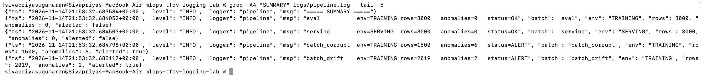
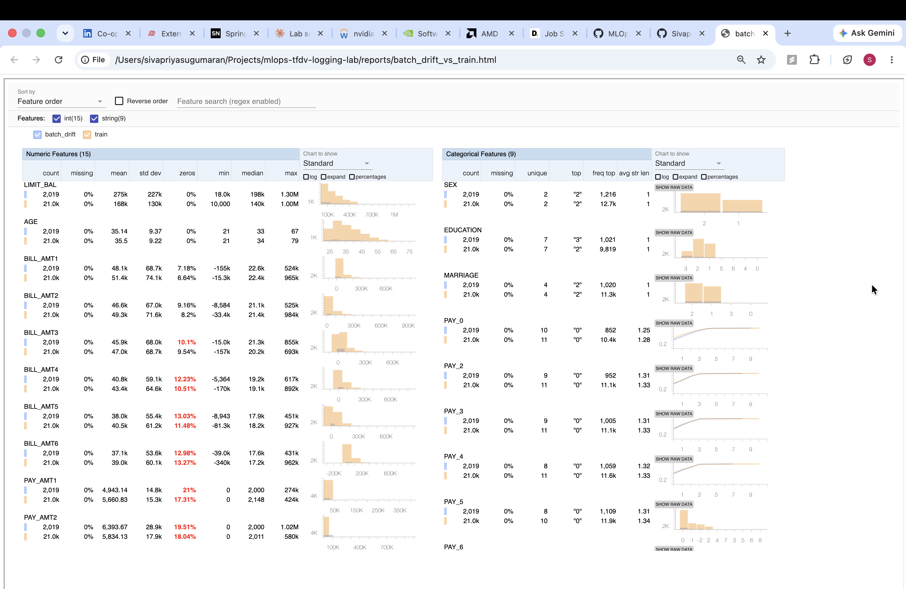
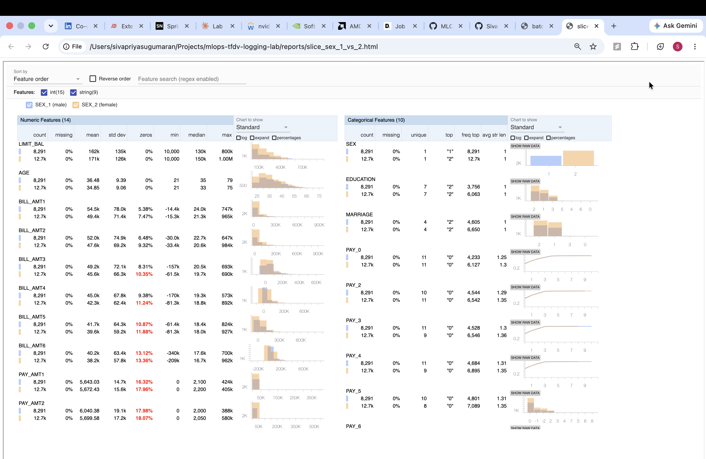
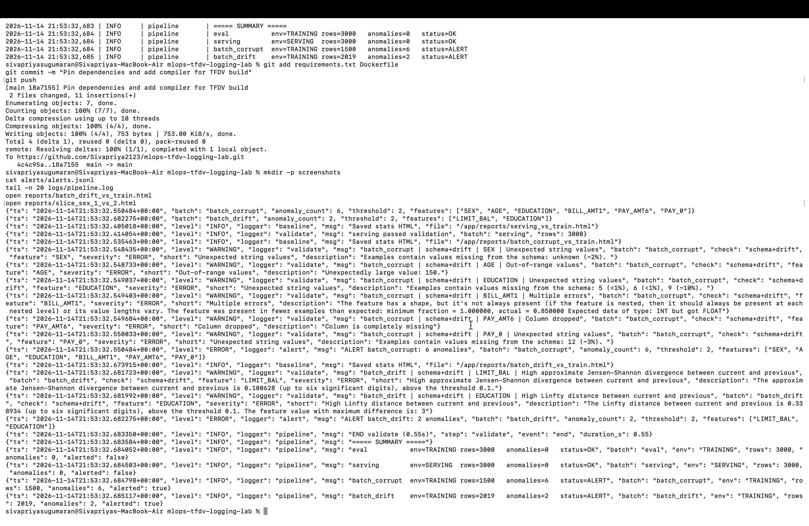
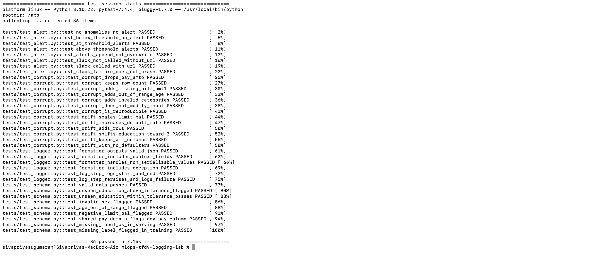

# Credit Data Validation Pipeline with TFDV + Structured Logging

MLOps Lab (IE7374). Based on the course **TFDV_Labs** (Lab1, Lab2, Lab3) and **Logging_Labs**, rebuilt as a production style pipeline on a new dataset. It validates incoming credit card data, logs every step as structured JSON, and raises alerts when data breaks, drifts or skews.

## What I changed from the course labs
- **New dataset:** UCI Default of Credit Card Clients (30K customers) instead of Adult Census, Chicago Taxi and Diabetes
- **Scripts + Docker** instead of notebooks, so the pipeline runs end to end with one command
- **Structured logging:** JSON logs with rotation, step timing and per anomaly context
- **Alerting:** threshold based alerts in `alerts/alerts.jsonl`, optional Slack webhook
- **Extra test batches:** a corrupted batch and a drifted batch on top of eval and serving
- **Numeric drift:** Jensen-Shannon divergence for LIMIT_BAL and AGE (labs only check categorical drift)
- **Bias check:** default rate logged per SEX and EDUCATION slice

## TFDV concepts covered (from Lab1 to Lab3)
| Concept | Where |
|---|---|
| Train stats + schema inference | `baseline.py` |
| Feature allowlist (drop ID column) | `baseline.py` |
| 70 / 10 / 10 split, label dropped in serving | `prepare_data.py` |
| Curated domains (documented codes only) | `baseline.py` |
| `min_domain_mass` relaxation (EDUCATION, MARRIAGE) | `baseline.py` |
| Shared domain for PAY_0 to PAY_6 (like Lab3's metformin domain) | `baseline.py` |
| Numeric ranges (AGE 18 to 100, LIMIT_BAL >= 0) | `baseline.py` |
| Schema environments (TRAINING vs SERVING) | `baseline.py`, `validate.py` |
| `infer_type_from_schema` | `baseline.py` |
| Drift (L-infinity) and skew comparators | `baseline.py`, `validate.py` |
| Data slicing by SEX and EDUCATION | `slicing.py` |
| Frozen schema | `schema/schema.pbtxt` |

## Logging concepts covered (from Logging_Labs)
| Concept | Where |
|---|---|
| Named loggers per module | `logger.py` (`get_logger`) |
| Log levels (INFO, WARNING, ERROR) | `validate.py`, `alert.py` |
| Multiple handlers (console + file) | `logger.py` |
| Custom formatter (JSON lines) | `logger.py` (`JsonFormatter`) |
| Log rotation (1 MB, 3 backups) | `logger.py` (`RotatingFileHandler`) |
| Contextual fields via `extra` | all modules |
| Exception logging with traceback | `logger.py` (`log_step`) |
| Step timing | `logger.py` (`log_step`) |

## Pipeline
```
prepare_data -> baseline (stats + curated schema) -> slicing -> validate batches -> log -> alert
```

## Run
```bash
docker build --platform linux/amd64 -t tfdv-logging-lab .
docker run --rm --platform linux/amd64 -v "$(pwd)":/app tfdv-logging-lab
```
Optional: `-e ALERT_THRESHOLD=3 -e DRIFT_THRESHOLD=0.15 -e SLACK_WEBHOOK_URL=<url>`


## Outputs
| Folder | Contents |
|---|---|
| `schema/` | frozen `schema.pbtxt`, `train_stats.pbtxt` |
| `reports/` | anomaly reports per batch, stats HTML (train, batch vs train, slice comparison) |
| `logs/` | `pipeline.log` (JSON lines) |
| `alerts/` | `alerts.jsonl` |

## Project structure
```
src/
  config.py        paths, thresholds, domains
  logger.py        JSON logger + step timer
  prepare_data.py  download + split data
  corrupt.py       corrupt and drift simulators
  baseline.py      stats, schema inference and curation
  slicing.py       sliced stats + default rate per group
  validate.py      schema, drift and skew checks
  alert.py         threshold alerts + Slack
  run_pipeline.py  runs everything
```

## Results
| Batch | Env | Rows | Anomalies | Status |
|---|---|---|---|---|
| eval | TRAINING | 3000 | 0 | OK |
| serving | SERVING | 3000 | 0 | OK |
| batch_corrupt | TRAINING | 1500 | 6 | ALERT |
| batch_drift | TRAINING | 2019 | 2 | ALERT |

**Findings**
- All 6 injected issues caught: invalid SEX, EDUCATION and PAY_0 codes, out of range AGE, missing BILL_AMT1 values, dropped PAY_AMT6
- Drift detected on EDUCATION (L-infinity 0.34, well above 0.1) and LIMIT_BAL (Jensen-Shannon 0.1006, just above 0.1). The LIMIT_BAL result is borderline, so the threshold would need tuning with domain knowledge in production
- Slicing shows a higher default rate for men (24.0%) than women (20.5%)






## Testing
36 pytest tests run inside the Docker image:
- `test_corrupt.py`: corrupt and drift simulators (exact counts, input not modified, reproducibility, edge case with no defaulters)
- `test_alert.py`: alert threshold, appending, Slack success and failure
- `test_logger.py`: JSON formatting, context fields, exception logging, failed steps re-raised
- `test_schema.py`: curated schema accepts valid data and flags invalid codes, out of range values and missing columns, with SERVING vs TRAINING environments

```bash
docker run --rm --platform linux/amd64 -v "$(pwd)":/app tfdv-logging-lab python -m pytest -v -p no:cacheprovider
```

The container runs as a non-root user (`appuser`).


